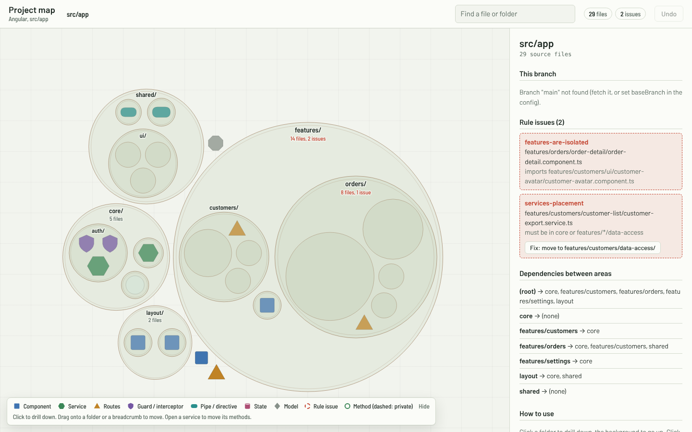
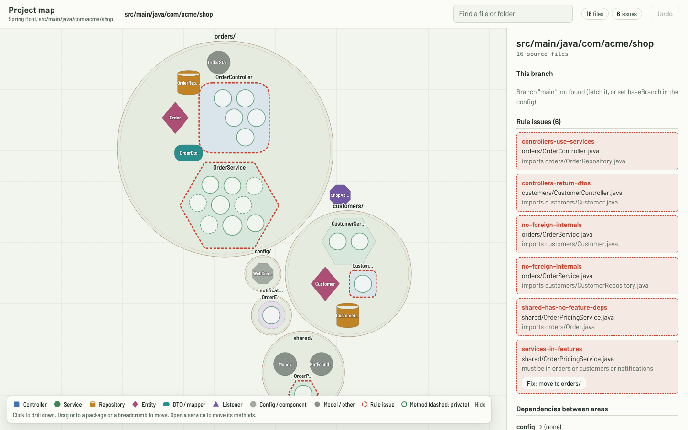

# Floorplan

[](https://github.com/BahaaKiali92/floorplan/actions/workflows/test.yml)


A Claude Code plugin for **Angular** and **Spring Boot (Java)** repositories that keeps the structure of an app in
view for Claude and for the team, and checks it against your rules: built-in ones, presets, and **the rules you
already wrote in CLAUDE.md**.


- **Your CLAUDE.md is the source of truth**: `/floorplan rules` turns the rules written there ("never use `any`",
  "services live in `services/`", "components use OnPush") into checks. Files that break them get warnings with the
  CLAUDE.md line they come from; where CLAUDE.md contradicts a built-in rule, CLAUDE.md wins.
- **Issues you can act on**: file and line, the rule and where it comes from, why it matters, and how to fix it
  (with the command when there is one), in the terminal, the map, pull-request comments, the graph, and for Claude
  right after it writes a file.
- **Structure map** Claude reads in every session (`docs/FLOORPLAN.md`), regenerated by CI after each merge to main.
- **Rules** for where code lives and what may use what: imports between features, layers, cycles, placement, naming,
  packages a part of the code must not use, lazy-loading boundaries, size, unused files, orphaned tests; Spring:
  controllers → services → repositories, constructor injection, `@Transactional` on methods Spring's proxy can't reach.
  Presets for feature-sliced Angular, Nx, layered and hexagonal Spring Boot. Reads your existing Sheriff, Nx, ESLint boundary and ArchUnit rules instead of duplicating them.
- **CI check that fails only on issues a branch introduces** (or when a rule's budget goes up), with a pull-request
  comment. Existing problems on main don't block anyone; documented exceptions go in an `accepted` list.
- **Edit check**: right after Claude writes a file that breaks a rule, it is told so, with the fix.
- **Bubble graph** in the browser: drill down, see dependencies, filter rule issues, drag files and folders (Java:
  classes and packages) to move them. Imports are rewritten, `git mv` keeps history, every move is previewed and can be
  undone. Keyboard navigation, save the view as PNG/SVG.
- **Method-move preview**: select methods in a service and drop them on another one; it reports callers, helpers,
  shared state, circular dependencies (Spring also proxy annotations) and a precise task for Claude.
- **Branch report**: what the branch changed, who uses the changed files, and the command that runs the related tests.
- **Planning help**: extraction planner (which files to move to `shared/` to fix cross-feature imports, and what that
  does to every rule), change coupling from git history, CODEOWNERS from folder owners.

Measured on the sample app: with the map, Claude fixed a misplaced service it was asked to extend instead of copying
the mistake, with ~13% lower cost ([details](docs/experiments/2026-10-12-with-without-map.md); `experiments/run.mjs`
repeats this on your own repository).

Tried on open-source repositories of different shapes (a feature-sliced app, an Nx workspace, the 2,000-file
angular/components repository mapped in under a second): [results](docs/experiments/2026-10-13-open-source-runs.md).
Spring Boot runs: petclinic, buckpal (hexagonal) and Apache Fineract (29 modules, 5,476 classes, 2.5 s).

Requirements: Claude Code, Node 18+, and an Angular project with `npm install` done, or a Spring Boot project (Maven or
Gradle; no build needed). No other dependencies, no network access (D3 and the font are bundled).

## Install

**As a plugin** (recommended), in Claude Code:

```
/plugin marketplace add BahaaKiali92/floorplan
/plugin install floorplan@floorplan
```

Or from a terminal: `claude plugin marketplace add BahaaKiali92/floorplan` and `claude plugin install floorplan@floorplan`.
Updates: `claude plugin update floorplan@floorplan`, or turn on auto-update for the marketplace in `/plugin`.
Once listed in Anthropic's community marketplace: `/plugin marketplace add anthropics/claude-plugins-community`, then
`/plugin install floorplan@claude-community`.

**Cloud sessions** (claude.ai/code, `claude --cloud`) don't install plugins. `/floorplan setup` offers to commit the
skill into the repository (`.claude/skills/floorplan/`); after that `/floorplan` works in every cloud session on that
repository with nothing to install.

**From the zip kit** (`floorplan-kit.zip`, for machines without GitHub access):

```bash
claude plugin marketplace add ./floorplan-kit/plugin-marketplace
claude plugin install floorplan@floorplan
```

**As a personal skill**: copy the skill folder (`plugin/skills/floorplan` in this repository, `skill/floorplan` in
the kit) to `~/.claude/skills/` (Windows: `$HOME\.claude\skills\`). To share it within one repository, copy it to
`<repo>/.claude/skills/floorplan` and commit it.

For a whole company: push the marketplace to a repository everyone can read; an admin can pre-install it through
managed settings (`extraKnownMarketplaces` + `enabledPlugins`). Details: [docs/1-SETUP.md](docs/1-SETUP.md).

## Use it

In an Angular or Spring Boot repository, in Claude Code (the plugin's command may show as `/floorplan:floorplan`):

| Command | What happens |
|---|---|
| `/floorplan setup` | Copies the tools to `scripts/floorplan/`, proposes a preset, folder purposes and rules (you confirm), adds npm scripts and a `CLAUDE.md` section, generates the first map. Once per repository. |
| `/floorplan rules` | Reads the project's CLAUDE.md files and turns their rules into checks (`floorplan.claude-rules.json`). Run again when CLAUDE.md changes; Floorplan tells you when. |
| `/floorplan update` | After updating the plugin: brings the repository's tools, CLAUDE.md section and (if you agree) config up to date. Also migrates repositories set up as "project-map". |
| `/floorplan` or `/floorplan map` | Refreshes the local map and branch report and summarizes the branch. |
| `/floorplan ui` | Starts the bubble graph at http://localhost:4321. |
| `/floorplan move <source> <target-folder>` | Moves a file or folder with all imports rewritten (dry run first). |
| `/floorplan move-methods <task>` | Paste the task copied from the graph; Claude makes the change on a branch and runs the checks. |

Without Claude: `npm run map`, `map:main` (CI), `map:check`, `map:ui`, and the scripts in `scripts/floorplan/`:
`move-cli.mjs`, `analyze-cli.mjs`, `generate-map.mjs --plan-extract <rule>`, `cochange.mjs`, `codeowners.mjs`.

Try it on a branch first: moves in the graph change the working copy (`git reset --hard` undoes everything); method moves
in the graph never change code.

## Documentation

| Document | Read it for |
|---|---|
| [docs/1-SETUP.md](docs/1-SETUP.md) | installing, setting up a repository, presets, the config file, CI, updating, rollout, troubleshooting |
| [docs/2-VALIDATION.md](docs/2-VALIDATION.md) | how the rules and checks work, exit codes, a step-by-step check with `sample-app/` |
| [docs/3-FEATURES.md](docs/3-FEATURES.md) | every feature and rule type, the graph, moves, CLIs, server API, limits |
| [docs/4-SPRING-BOOT.md](docs/4-SPRING-BOOT.md) | Spring Boot: kinds, rules, class/package moves, method moves, walkthrough with `sample-spring-app/` |





## Known limits

- Angular and Spring Boot (Java). Not yet: Kotlin, React, Vue.
- Relative `@use`/`@import` paths inside moved `.scss` files are not rewritten (the preview warns).
- "Imports used only as types" is detected for interfaces and type aliases (also through barrel files), not for
  classes that happen to be used only in type positions.
- Undo in the graph lasts while the server runs; after that use git.

## Develop

```bash
./tests/run.sh                # end-to-end tests on temp copies of sample-app/ and sample-spring-app/
./scripts/build-kit.sh        # dist/floorplan-kit.zip
claude plugin validate .      # manifest check
```

The skill lives in `plugin/skills/floorplan/` (one copy). On Windows run the scripts with Git Bash and set
`git config core.fileMode false` once per clone. See [CLAUDE.md](CLAUDE.md) for the layout and working rules, and
[CONTRIBUTING.md](CONTRIBUTING.md) to report how it worked on your project.

License: [MIT](LICENSE).
